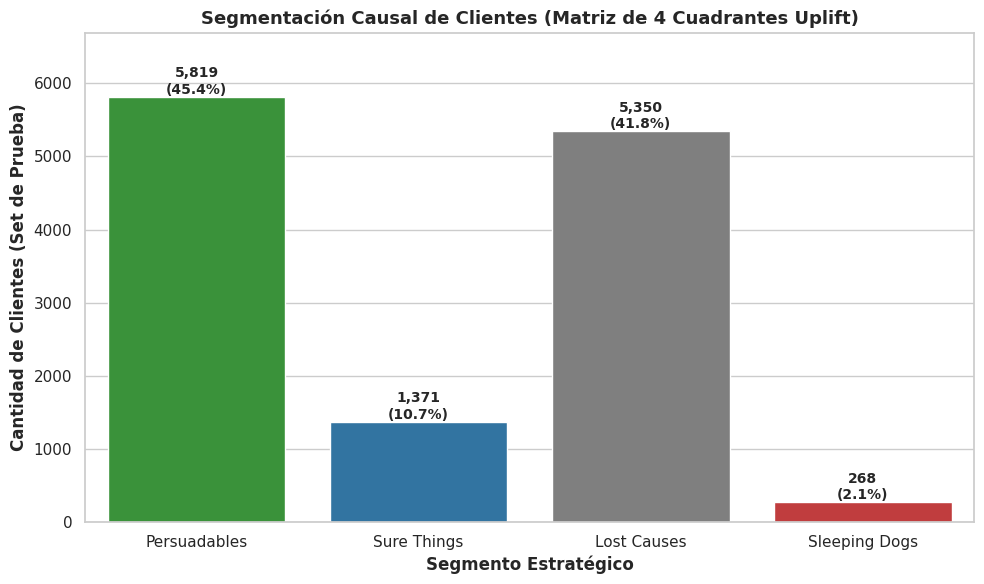
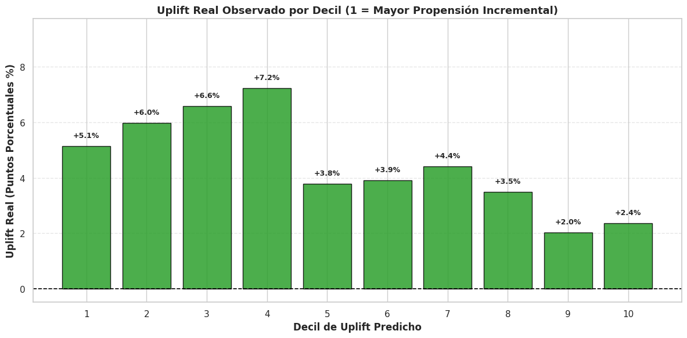
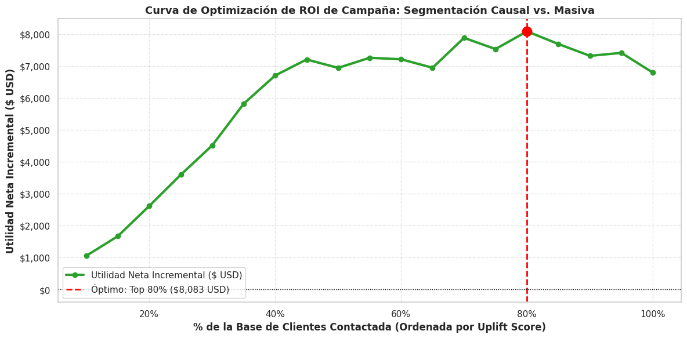

# Customer Retention & Campaign ROI Optimization via Uplift Modeling

## Resumen Ejecutivo
Este proyecto desarrolla una solución de **Inferencia Causal y Experimentación A/B** aplicada a estrategias de retención y reactivación de clientes (42,693 registros experimentales). En lugar de enviar promociones masivas o usar modelos tradicionales de propensión que subsidian a clientes orgánicos, se implementó un **T-Learner con LightGBM** para estimar el impacto incremental individual (*Uplift Score*) y maximizar el retorno financiero (ROI) de la campaña.

### Impacto Financiero Estimado (Set de Prueba)
* **Campaña Masiva (Contactar 100% de la base):** Utilidad Neta Incremental de **$6,792.03 USD**
* **Campaña Focalizada por Uplift (Top 80%):** Utilidad Neta Maximizada de **$8,085.54 USD**
* **Valor Generado:** **+$1,293.51 USD (+19.0% de utilidad incremental)** mientras se **ahorra el 20% del presupuesto promocional** y se excluye al segmento con reacción negativa (*Sleeping Dogs*).

*(Incluye en este repositorio la presentación ejecutiva `Presentacion_Ejecutiva_Uplift.pptx` y el resumen ejecutivo en audio `Podcast_Ejecutivo_Uplift.mp3`).*

---

## Hallazgos Clave y Metodología

### 1. Auditoría Estadística del Experimento (A/B Testing)
Se verificó el balanceo de covariables previas mediante pruebas *t-test* (`recency p = 0.5925`, `history p = 0.5012`), confirmando una aleatorización limpia. A nivel agregado, la campaña elevó la reactivación del **10.62% al 15.14%** (`Lift Absoluto: +4.52%` | `Lift Relativo: +42.61%` | `p-value = 3.18e-44`).

### 2. Segmentación Causal: Matriz de 4 Cuadrantes
El modelo contrafactual clasifica a cada cliente según su respuesta real al incentivo:
* **Persuadables (45.4%):** Regresan gracias a la promoción (foco principal de inversión).
* **Lost Causes (41.8%):** No regresan aun con incentivo (presupuesto perdido).
* **Sure Things (10.7%):** Regresan de forma orgánica sin necesidad de subsidio.
* **Sleeping Dogs (2.1%):** Reacción negativa ante la campaña (exclusión obligatoria).

### 3. Validación por Deciles de Uplift
Al ordenar la cartera por propensión incremental, los primeros 4 deciles (Top 40%) capturan entre **+5.1% y +7.2%** de reactivación adicional real, mientras los deciles inferiores caen a **+2.0%**.

### 4. Optimización de ROI de Campaña (P&L)
Simulación financiera de cobertura vs. margen neto generado ($45 USD por cliente reactivado vs. $1.50 USD de costo promocional).

---
**Stack Tecnológico:** Python, Pandas, NumPy, SciPy, Statsmodels, Scikit-Learn, LightGBM, Matplotlib/Seaborn, python-pptx, edge-tts.

